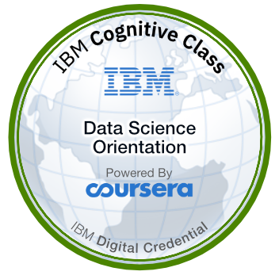

# 👋 Hi, I'm Pablo Iribarren

Networked Computer Systems Administration technician (ASIR) with training in **Artificial Intelligence and Data Science** (UNIR). I enjoy building things from scratch — pipelines, dashboards, apps — and understanding how data works from the infrastructure layer up.

---

## 🎓 Certifications

  

---

## 🚀 Featured Projects
- **[Madrid Rental Price Prediction — MLOps on AWS](https://github.com/pablooiiribarren/madrid-rental-price-mlops)**
  End-to-end MLOps pipeline on AWS SageMaker: PySpark ETL in AWS Glue, S3 data lake,
  Bayesian hyperparameter tuning (R² from 0.719 to 0.787), bias auditing with
  SageMaker Clarify, real-time inference endpoint and monitoring with Model Monitor.

- **[Irish Property Price Register — SQL Analysis](https://github.com/pablooiiribarren/irish-ppr-sql-analysis)**
  End-to-end data pipeline built on Ireland's official residential property 
  price dataset. Python (pandas, SQLAlchemy) for ingestion, MySQL/MariaDB 
  for all analytical work, and Plotly for visualization. 
  Built to demonstrate practical SQL skills on real-world data.

- **[Data Science Job Market Spain](https://github.com/pablooiiribarren/data-science-job-market-spain)**
  Full pipeline analyzing 2,000+ real job listings in Data Science, AI and ML 
  across Spain, scraped from the Adzuna API. Covers EDA, salary prediction 
  (Ridge, Random Forest, Gradient Boosting) and an interactive Streamlit dashboard.  
  🔗 [Live demo](https://data-science-job-market-spain-pablooiiribarren.streamlit.app/)

- **[Monitoring Scripts Lab](https://github.com/pablooiiribarren/monitoring-scripts-lab)**
  A lightweight Linux monitoring lab showcasing automation and scripting skills.
  Python and Bash scripts to check system services, CPU, memory and disk usage —
  with configurable thresholds, professional logging and a simple alerting system.  

---

## 🧠 Areas of Interest

- Data Analysis and Business Intelligence
- Applied Artificial Intelligence and ML
- Data Engineering and pipeline design
- Cloud infrastructure and deployment with Docker / AWS

---

## 🛠️ Tech Stack

**Languages:** Python, SQL, Bash  
**Data analysis:** pandas, NumPy, SQLAlchemy  
**Machine Learning:** scikit-learn, Keras / TensorFlow, PyTorch, Hugging Face Transformers  
**Big Data & Cloud:** PySpark, AWS (S3, Glue, SageMaker)  
**Databases:** MySQL / MariaDB  
**Visualization:** Plotly, Streamlit, Matplotlib, Seaborn  
**Systems & Tools:** Linux, Windows Server, Docker, Git

---

## 🌐 Connect with Me

- 💼 [LinkedIn](https://www.linkedin.com/in/pablo-iribarren-muru)  
- ✉️ [Email me](mailto:p11iribarren@gmail.com) 
  
---

## 🏆 GitHub Trophies

<picture>
  <source media="(prefers-color-scheme: dark)" srcset="https://raw.githubusercontent.com/pablooiiribarren/pablooiiribarren/output/github-snake-dark.svg" />
  <source media="(prefers-color-scheme: light)" srcset="https://raw.githubusercontent.com/pablooiiribarren/pablooiiribarren/output/github-snake.svg" />
  
</picture> 

---

<!-- Proudly created with GPRM ( https://gprm.itsvg.in ) -->
